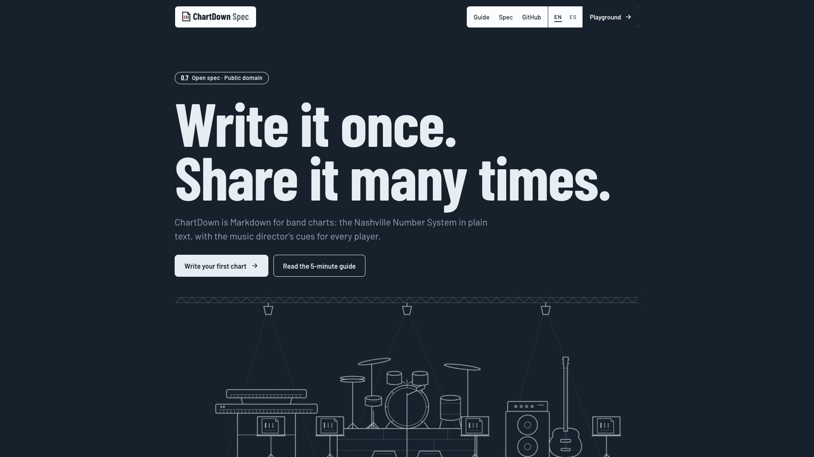

<h1><picture><source media="(prefers-color-scheme: dark)" srcset="assets/logos/logo-lockup-dark.svg"></picture></h1>

**An open, plain-text notation for Nashville Number System charts, with music director cues for every player.**

[](https://chartdown.github.io/spec/)

**[chartdown.github.io/spec](https://chartdown.github.io/spec/)** · [Playground](https://chartdown.github.io/spec/playground/) · [Guide](docs/guide.md) · [Guía en español](docs/guia.md)

ChartDown is to band charts what Markdown is to documents: you write simple text,
and any ChartDown-compatible tool turns it into a clean, readable chart.

```
## Chorus
> MD: Open it up a little. Don't go all out yet.
> MD drums: Light groove, hi-hat or ride.
{mf} 4 "Take the open road" {drums: in} | 1 | 5 | 6m
4 | 1 | 5sus 5 | 1
```

That is a section name, two music director (MD) notes (one for the whole band,
one only for the drummer), a dynamic, a short lyric landmark, a cue for one
instrument, and eight bars of chords.

## Why ChartDown

- **Plain text.** A chart is a `.chartdown` file you can read, diff, and keep forever.
- **Made for the music director.** MD notes are part of the language. Write them
  for the whole band or for one instrument, and each player can read just their part.
- **Any song.** Major or minor keys, any meter (3/4, 6/8, 12/8), key changes,
  pushes, stabs, holds, repeats and endings.
- **Numbers or letters.** Write either, show either, transpose on the fly.
- **Open.** The spec is public domain (CC0). The reference code is MIT. Anyone can
  build a ChartDown app.

## Try it in 30 seconds

1. Open the [playground](https://chartdown.github.io/spec/playground/). It loads an example song.
2. Replace the text with this and watch the chart redraw as you type:

   ```
   ---
   key: G
   ---
   ## Verse
   > MD drums: Sit out until the chorus.
   1 | 4 1 | 6m 5 | 4 1
   ```

3. Set **View** to *Drums* to read the chart as the drummer, or switch to
   **Letters** and pick another **Key** to transpose it.

## Get started

1. Read the [quick guide](docs/guide.md) ([en español](docs/guia.md)).
2. Try the [online playground](https://chartdown.github.io/spec/playground/) and edit an
   example. It also works offline: open `playground/index.html` in a browser.
3. Check the full rules in the [specification](SPEC.md).

## Repository

| Path | What it is |
|---|---|
| `SPEC.md` | The ChartDown specification (version 0.10, draft) |
| `docs/guide.md` | Quick guide in English |
| `docs/guia.md` | Guía rápida en español |
| `examples/` | Example charts (original songs written for this repo, and the public domain hymn Amazing Grace) |
| `playground/index.html` | Reference parser and renderer in one HTML file, no dependencies |
| `conformance/` | Official test cases for parsers, and a runner: `node conformance/run.mjs` |
| `CHANGELOG.md` | Version history |
| `CONTRIBUTING.md` | How to propose changes |

## Implementations

- [ChartDown/parser](https://github.com/ChartDown/parser): a JavaScript parser for
  ChartDown 0.8 that passes every case in `conformance/`. Install it from npm as
  [`chartdown`](https://www.npmjs.com/package/chartdown).
- Building your own? Run `node conformance/run.mjs ./your-adapter.mjs` against it
  and open an issue to be listed here.

## Licenses

- **Specification, guides, examples and conformance cases:** [CC0 1.0](LICENSE-SPEC). No rights reserved.
- **Reference code** (`playground/`, `conformance/run.mjs`): [MIT](LICENSE).

## Name and compatibility

Anyone may build tools that read or write ChartDown and say they are
**"compatible with ChartDown"** or **"support ChartDown files"**. Please don't name
your product "ChartDown" or present it as the official one. The official app is
**ChartDown App** at [chartdown.app](https://chartdown.app).

## Lyrics and rights

ChartDown is for song structure, not for storing lyrics. Lyric landmarks are limited
to 8 words. Respect songwriters and publishers, and check your own license before
copying lyrics into any tool.
